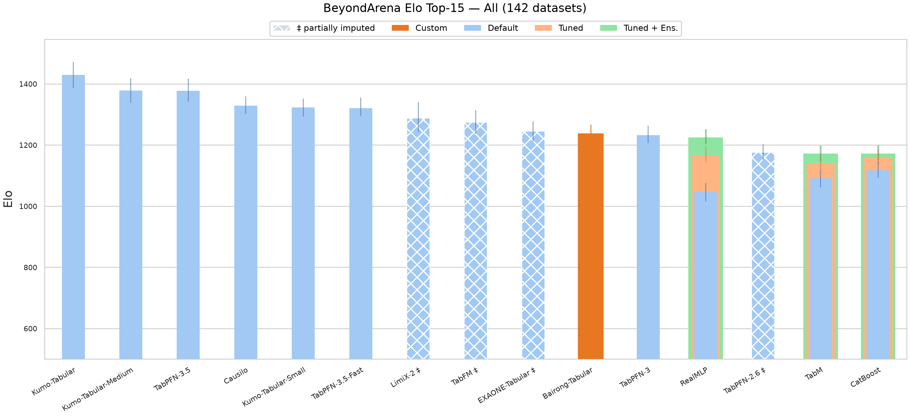

# TabAbax

Scikit-learn estimators for tabular classification and regression. `fit` stores the training table as context. `predict` runs one forward pass of a pretrained model. The model weights are not updated.

This repository is the inference package. It is what AutoGluon and TabArena import. It does not contain pre-training, fine-tuning, data priors, or checkpoints.

## Results

TabAbax predicts on unseen tabular datasets in one forward pass, without task-specific training.



On the full BeyondArena suite (142 datasets: 98 classification and 44 regression), TabAbax reaches an Elo of 1,238 and ranks 10th of 41 methods.

## Install

Python >= 3.10.

From a clone, install the inference dependencies and then the package:

```bash
pip install -r requirements.txt
pip install -e .
```

`requirements.txt` lists torch, scikit-learn, numpy, scipy, pandas, einops, psutil, tqdm, and huggingface-hub. The same list is in `pyproject.toml`, so this also works:

```bash
pip install -e .
```

From the private GitHub repository:

```bash
pip install "git+https://github.com/tababax-research/TabAbax.git"
```

## Weights

Leave `model_path` unset. The first `fit` downloads the public checkpoint from [tababax-ai/tababax](https://huggingface.co/tababax-ai/tababax) and stores it in the Hugging Face cache (`~/.cache/huggingface/hub`, or the directory in `HF_HOME`). Later runs reuse that file.

| Estimator | File |
| --- | --- |
| `TabAbaxClassifier` | `tababax-classifier.ckpt` |
| `TabAbaxRegressor` | `tababax-regressor.ckpt` |

The checkpoints on [tababax-ai/tababax](https://huggingface.co/tababax-ai/tababax) are licensed under CC-BY-NC-4.0. That license is separate from the Apache-2.0 terms for this source code. Set `allow_auto_download=False` to refuse a download. Pass `model_path` when the checkpoint is already on disk; an existing file is loaded and nothing is downloaded.

```python
TabAbaxClassifier(model_path="path/to/classifier.ckpt", allow_auto_download=False)
```

## Usage

The defaults are the recommended settings. No checkpoint path is required.

```python
from tababax import TabAbaxClassifier, TabAbaxRegressor

clf = TabAbaxClassifier()
clf.fit(X_train, y_train)
clf.predict(X_test)
clf.predict_proba(X_test)

reg = TabAbaxRegressor()
reg.fit(X_train, y_train)
reg.predict(X_test)
```

Inputs may be NumPy arrays or pandas DataFrames. String and categorical columns are encoded inside `fit`.

Recommended defaults:

| Parameter | Default | What it does |
| --- | --- | --- |
| `n_estimators` | `8` | Number of dataset views in the ensemble. `1` is a single forward pass. |
| `batch_size` | `1` | Ensemble members forwarded together. `None` sends every member in one batch. |
| `model_path` | `None` | Local checkpoint. Unset means download the file named by `checkpoint_version`. |
| `allow_auto_download` | `True` | Download that file when `model_path` is missing or does not exist. |
| `checkpoint_version` | classifier: `tababax-classifier.ckpt`; regressor: `tababax-regressor.ckpt` | File name on `tababax-ai/tababax`. |
| `device` | `None` | CUDA when it is available, otherwise XPU, MPS, then CPU. |
| `use_amp` | `"auto"` | Mixed precision from the table size. Stays off for small tables and on CPU. |
| `use_fa3` | `False` | FlashAttention-3. Leave this off unless the runtime provides it. |
| `offload_mode` | `"auto"` | Places the large column embedding in GPU, CPU, or disk memory according to what is free. |
| `random_state` | `42` | Ensemble shuffling. |

## AutoGluon and TabArena

The integration surface is the two estimators:

- `tababax.TabAbaxClassifier`: `fit`, `predict`, `predict_proba`
- `tababax.TabAbaxRegressor`: `fit`, `predict`

No extra server or training entry point is required. A caller constructs the estimator with the defaults above and uses the scikit-learn API. Pass `model_path` only when the checkpoint should come from a local file.

## Layout

```
src/tababax/_model/     architecture and in-context forward pass
src/tababax/_sklearn/   estimators, preprocessing, checkpoint loading
tests/test_import.py          public import check
```

`_model/learning.py` is the in-context forward path. It is not a pre-training loop.

## License

The inference source in this repository is licensed under Apache-2.0. See `LICENSE`.

The pretrained weights downloaded by default are not covered by that license. They are published at [tababax-ai/tababax](https://huggingface.co/tababax-ai/tababax) under CC-BY-NC-4.0 and are restricted to non-commercial use. Commercial use of those weights is not permitted.
